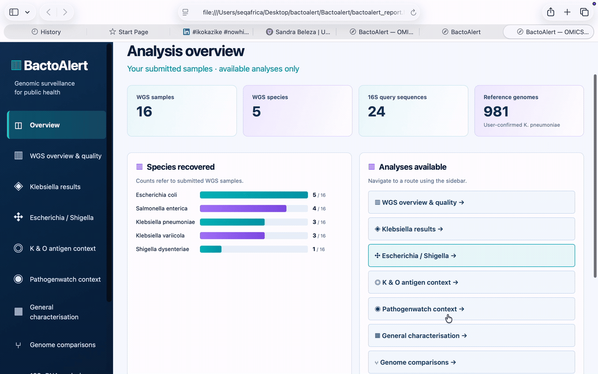

# BActoAlert

**Bacterial characterisation and contextual reporting — developed by Team OmixSTAR.**

[](https://www.nextflow.io/)
[](https://www.docker.com/)

## Overview

BActoAlert connects bacterial genome assembly, quality assessment, species identification, characterisation and interactive reporting in a modular Nextflow workflow. It is designed for laboratories that have sequencing data but limited capacity to run individual bioinformatics tools and combine their outputs.

The pipeline accepts WGS reads, existing genome assemblies and prepared 16S rRNA sequences. It is designed to operate offline **after all software, container images, plugins and databases have been prepared locally**. Initial deployment and interpretation still require technical support.

BActoAlert is a research prototype. Analytical validation, usability assessment and evaluation of its effects on reporting turnaround remain ongoing work.

## See BActoAlert in action

A 30-second preview of the interactive report, showing how users explore
quality assessments, bacterial characterisation and available comparisons.



*Playback is accelerated; this is a report demonstration, not pipeline execution time.*

## Analysis routes

| Input or stage | Analysis |
| --- | --- |
| Short-read WGS FASTQ | Preprocessing and Shovill assembly |
| Long-read WGS FASTQ | Preprocessing and Dragonflye assembly |
| Paired short and long reads | Hybrid assembly with Unicycler |
| WGS assembly FASTA | Assembly preparation, QC and species identification without reassembly |
| Assembly quality | QUAST, CheckM2 and reporting against a versioned QualiBact threshold snapshot |
| Species identification | Speciator, followed by species normalisation and routing |
| Klebsiella complexes | Kleborate `kpsc` and `kosc` presets |
| Escherichia/Shigella | Kleborate `escherichia` preset |
| Other bacteria | AMRFinderPlus, MLST, VirulenceFinder and PlasmidFinder; interpretation depends on database coverage |
| Within-species comparisons | Mash distances, Mashtree trees and optional SKA-based SNP comparisons |
| Reference-based comparisons | Optional Snippy workflow with a supplied local reference; optional recombination analysis |
| Prepared 16S FASTA | Sequence QC and BLASTN against a locally packaged NCBI 16S database |
| Reporting | Automated preparation of reporting tables and an interactive R/Quarto HTML report |

16S analysis is independent of WGS. It accepts prepared sequences, not raw 16S amplicon reads. Multiple sequences in a 16S FASTA are reported separately.

## Installation and preparation

```bash
git clone https://github.com/jgoke1/BactoAlert.git
cd BactoAlert
```

Requirements:

- Nextflow **24.10.3 or later**, with a compatible Java installation.
- Docker installed and running for the default `standard` profile.
- Sufficient CPU, memory and disk space for the selected analyses. The configuration uses per-task resource limits; these are not guarantees of total run requirements.
- Readable input files and writable work/output directories.
- A local QualiBact snapshot, required by the reporting workflow.
- A prepared local NCBI 16S database when running the 16S branch.
- Optional external reference files in the format expected by the reporting application.

Linux is the primary execution target. Check container architecture and tool compatibility before deploying on another platform. The `bmrc` profile contains institution-specific settings and must be adapted before use elsewhere.

The reporting process uses `jgoke1/bactoalert-report:0.1.0`. Download required images while connected, or transfer them with `docker save` and `docker load`.

## Sample sheets

Use absolute file paths where possible. Sample IDs must begin with a letter or number and contain only letters, numbers, underscores, dots or hyphens. WGS sample IDs must be unique across the read and assembly sheets.

### WGS reads: `samplesheet.csv`

```csv
sample_id,short_reads1,short_reads2,long_reads,genome_size
isolate_short,/data/short_R1.fastq.gz,/data/short_R2.fastq.gz,,
isolate_long,,,/data/long.fastq.gz,
isolate_hybrid,/data/hybrid_R1.fastq.gz,/data/hybrid_R2.fastq.gz,/data/hybrid_long.fastq.gz,
```

Supply both short-read mates or leave both empty. Supplying short and long reads in the same row selects hybrid assembly.

### WGS assemblies: `samplesheet_fasta.csv`

```csv
sample_id,fasta
isolate_assembly,/data/isolate_assembly.fasta
```

### Prepared 16S sequences: `samplesheet_16s.csv`

```csv
sample_id,fasta
sample_16s,/data/sample_16s.fasta
```

FASTA sheets accept `.fa`, `.fna` and `.fasta`, optionally gzip-compressed. Paths must not contain spaces.

## Running BActoAlert

Run commands from the repository directory. Replace example paths and identifiers with your own.

### WGS reads only

```bash
nextflow run main.nf -config nextflow.config \
  --input_type wgs --input_format fastq \
  --samplesheet samplesheet.csv \
  --run_id WGS_001 \
  --outdir output_wgs
```

### Existing assemblies only

```bash
nextflow run main.nf -config nextflow.config \
  --input_type wgs --input_format fasta \
  --fasta_samplesheet samplesheet_fasta.csv \
  --run_genome_similarity true --run_ska_snp true \
  --run_id FASTA_001 \
  --outdir output_fasta
```

### 16S only

```bash
nextflow run main.nf -config nextflow.config \
  --input_type 16s \
  --rrna16s_samplesheet samplesheet_16s.csv \
  --rrna16s_db "$PWD/16s" \
  --run_id RRNA16S_001 \
  --outdir output_16s
```

### WGS reads, WGS assemblies and 16S together

```bash
nextflow run main.nf -config nextflow.config \
  --input_type both --input_format fastq \
  --samplesheet samplesheet.csv \
  --fasta_samplesheet samplesheet_fasta.csv \
  --rrna16s_samplesheet samplesheet_16s.csv \
  --rrna16s_db "$PWD/16s" \
  --run_genome_similarity true \
  --run_ska_snp true \
  --run_snp_phylogeny false \
  --snp_recombination false \
  --collect_results false \
  --run_id COMBINED_001 \
  --outdir output_all
```

`both` means **WGS plus 16S**, not FASTQ plus FASTA. To combine WGS reads and assemblies without 16S, use `--input_type wgs` with both WGS sample sheets. `--input_format` applies to `--samplesheet`; `--fasta_samplesheet` always contains assemblies.

Append `-resume` to reuse valid cached tasks after an interruption. Keep the work directory and Nextflow cache for resuming.

## Reporting and external context

Reporting runs automatically after its inputs are prepared. Supply a scientist-defined `--run_id` for every run. Reports are published under:

```text
<outdir>/reports/<run_id>/
```

Report sections depend on available results and may include WGS QC, Klebsiella characterisation, Escherichia/Shigella characterisation, general bacterial characterisation, within-species genome comparisons and independent 16S results.

The configured QualiBact snapshot is required. To use a different prepared snapshot, add:

```bash
--qualibact_dir /absolute/path/to/qualibact_snapshot
```

External contextualisation is optional and requires compatible local reference files:

```bash
--report_reference_dir /absolute/path/to/reference
```

The intended resources serve separate purposes:

- **KlebNET neonatal sepsis collection hosted on Pathogenwatch:** descriptive context for local K. pneumoniae sequence types and available resistance and virulence features.
- **Independent K/O antigen reference data from KlebNNSapp:** comparisons of predicted K loci and O types.

Record source, download date, inclusion criteria and retained record counts for each snapshot. A directory of arbitrary downloads is not necessarily compatible with the reporting parser. Check the generated report to confirm reference records loaded successfully. General-characterisation and Escherichia results are reported locally without these external comparisons.

`--collect_results` controls the additional result collection step. It does not switch off the HTML reporting process.

## Preparing the local 16S database

Place the extracted NCBI `16S_ribosomal_RNA` BLAST database files in a local directory. The workflow also expects a `database.json` manifest generated by the supplied helper:

```bash
python3 bin/rrna16s.py database \
  --db-dir "$PWD/16s" \
  --version "NCBI_16S_packaged_$(date -u +%F)"
```

Use a compatible Python environment, such as Python 3.11. This command packages/checksums an **already downloaded** database; it does not download the database. Its date labels the packaging event, not the upstream database release date.

Transfer the complete database directory, including `database.json`, when moving to another workstation. Preserve the files unchanged for checksum verification.

## Output organisation

The selected branches determine which outputs exist. Main output categories include:

- Assemblies, read and assembly QC, and species identification results.
- `species_normalisation/summary/`: cohort taxonomy summaries.
- `species_groups/`: species-grouped normalisation outputs.
- `kleborate/`: Kleborate outputs organised by configured preset/report paths.
- Species-organised MLST, AMR, virulence and plasmid marker reports.
- `genome_similarity/` and `ska_snp/`: eligible within-species comparisons.
- `snp_phylogeny/`: optional reference-based comparisons.
- 16S identification and query summaries.
- `reports/<run_id>/`: the generated reporting bundle.

Missing, skipped or failed analyses must not be interpreted as negative biological results.

## Offline deployment

Before disconnecting, prepare the pipeline checkout, Nextflow runtime and plugin cache, all required container images, tool databases, the QualiBact snapshot and any contextual reference snapshots. Tool-level database downloads must also be completed in advance.

Test the intended analysis on the deployment workstation with networking disabled. Opening an HTML report offline or running a container's help command does not demonstrate complete offline pipeline execution.

## Troubleshooting

- **Missing `ps` during task monitoring:** the affected container needs `ps` (usually provided by `procps`). Use a compatible image containing it. Installing it on the host does not install it inside Docker.
- **Input permission errors:** check the source files, parent directories and symlink targets are readable by the container user and accessible through mounts.
- **Missing `database.json`:** package the downloaded 16S database with the helper above.
- **No external contextualisation:** supply `--report_reference_dir` and confirm the report actually loaded reference records.
- **Trace/report files already exist:** use new filenames or explicitly configure overwrite. Execution monitoring is optional and separate from the BActoAlert biological report.
- **Failed task:** inspect `.command.err`, `.command.out` and `.command.sh` in the work directory printed by Nextflow. Correct the cause before resuming; avoid ignoring failures in required QC or species-routing processes.

## Interpretation and limitations

- Resistance genes do not replace phenotypic antimicrobial susceptibility testing.
- Hypervirulence-associated markers do not independently establish clinical hypervirulence.
- K-locus and O-type predictions do not establish vaccine effectiveness.
- Mash distances and SNP counts are different measures; shared sequence types or short distances alone do not prove transmission.
- External collections are descriptive comparators, not estimates of national prevalence or proof of geographical origin.
- 16S similarity results may not resolve closely related species.

BActoAlert supports research and surveillance investigation. Clinical performance and public health impact have not been established.

## Team, attribution and resources

BActoAlert was developed by **Team OmixSTAR** for the Africa STAR Fellowship Impact Challenge.

Team members: Joseph Adegoke, Reiche Golmard Elenga, Lum Abienwi Ambe and Hafeez Adekola.

Assembly components were adapted from [GHRU-assembly](https://github.com/cgps-discovery/GHRU-assembly). We acknowledge its contributors: Julio Diaz Caballero, Varun Shammana, Angela Sofia Garcia, Christopher Ocampo and Nabil-Fareed Alikhan. The upstream README identifies the GHRU project as funded by NIHR; this acknowledgement does not imply funding or endorsement of BActoAlert.

Please acknowledge and cite the original tools and reference datasets used in your analysis, including:

- [Kleborate](https://github.com/klebgenomics/Kleborate)
- [Pathogenwatch](https://pathogen.watch/)
- [KlebNNSapp](https://github.com/klebgenomics/KlebNNSapp)
- The assembly, QC, characterisation and comparison tools listed above.

Retain upstream attribution and applicable third-party licence notices when redistributing software or databases. This README does not grant additional rights over third-party components.

For issues and development discussions, use [BActoAlert GitHub Issues](https://github.com/jgoke1/BactoAlert/issues).
